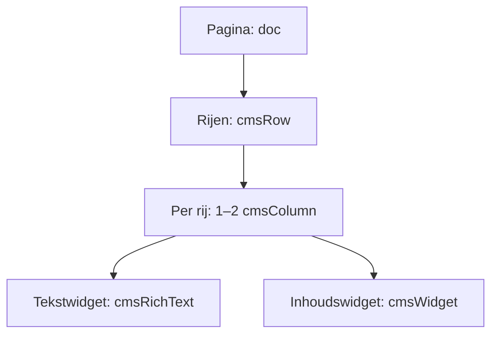

# Echte paginabouwer: rijen, kolomcontainers en widgets

Status: bouwspecificatie voor Codex op de development-VPS. Deze functionaliteit is **nog niet gebouwd** in het Sites-concept. De huidige bron is onderzocht op 13 oktober 2026; de overdracht gebruikt Sites-versie 44, commit `e91ed87f3e5917f286885c6593fe397f8e67cdf4` (de onderzochte CMS-onderdelen zijn gelijk aan versie 43). Dit document bepaalt het gewenste gedrag; de bestaande vormgeving van Duindorp SV blijft het uitgangspunt.

## 1. Wat de gebruiker bedoelt

Een pagina bestaat uit verplaatsbare rijen. Iedere rij heeft één brede container of twee containers naast elkaar. In elke container kunnen meerdere losse widgets onder elkaar staan. Een beheerder kan een widget naar een andere container of rij slepen. Zo kunnen bijvoorbeeld twee bestuurders naast elkaar staan, met daaronder een brede tekst en daaronder een foto naast een contactformulier.

Er zijn maximaal **twee layoutkolommen per rij**. Dit gaat over de pagina-indeling; een galerijwidget mag binnen zijn eigen ruimte een responsief fotogrid tonen. Rijen en kolomcontainers mogen niet opnieuw in een kolom genest worden. De bouwdiepte blijft overzichtelijk.

De pagina-editor, de tekstopmaak binnen een tekstwidget en de redacteur voor Nieuws en Verhalen hebben verschillende verantwoordelijkheden. Nieuws en Verhalen gebruiken de bestaande Tiptap-redactiewerkwijze; de layoutbouwer is voor algemene pagina's. Columns blijven Verhalen met `storyFormat:'column'` en worden niet ongemerkt nieuwsberichten.

## 2. Verschil met de huidige code

| Onderdeel | Bestaande bron | Opdracht voor de VPS |
| --- | --- | --- |
| `components/cms/block-editor.tsx` | Eén Tiptap-document met tekst en atomaire `cmsWidget`-nodes. `moveWidget` verwisselt alleen directe documentkinderen. | Echte geneste rijen en kolommen met verplaatsingen over containergrenzen. |
| Widget `columns` | Een kaart met een array eenvoudige titel-/tekstvelden. De inhoud heeft geen eigen versleepbare widgets. | Niet meer aanbieden voor nieuwe inhoud; vervangen door layoutcontainers. Bestaande inhoud veilig migreren. |
| `lib/cms/types.ts` | `PageContent.body` is Tiptap JSON. Geen versie voor een pagina-layout. | Expliciet `bodyFormat` toevoegen en versieerbare validatie/migratie invoeren. |
| `components/cms/public-content.tsx` | Eigen `CmsRichText` / `RichNode` / `Widget`-renderer; onbekende nodes vallen terug op hun kinderen. | Eén gedeelde gevalideerde layout-renderer voor publicatie en preview. Onbekende nodes expliciet behandelen. |
| Publiceren | Concepten, live snapshots en revisies bestaan al. | Dit onderscheid behouden bij alle layoutbewerkingen en migraties. |

De huidige `columns`-widget uitbreiden met twee tekstvelden voldoet dus niet aan de opdracht. Een CSS-grid rondom het bestaande platte document voldoet evenmin.

## 3. Canoniek documentmodel

Voeg aan iedere `PageContent`-snapshot `bodyFormat:'page-layout-v2'` toe zodra de conversie is uitgevoerd. Een ontbrekende waarde betekent `legacy-tiptap-v1`. Dit geldt afzonderlijk voor concept, live snapshot en revisies. Verander het bestaande `CmsState.schemaVersion` niet impliciet vanwege deze lokale wijziging; de algemene datamigratie krijgt een eigen gecontroleerde stap.

`body` blijft Tiptap/ProseMirror JSON. De canonieke boom is:

Gebruik één Tiptap-document en één undo-/redo-geschiedenis voor de pagina. Maak geen onafhankelijke editors per rij met losse kopieën van de inhoud. Voor tekstwidgets gebruikt de NodeView de inhoud van datzelfde document; instellingen in de zijbalk werken met transacties op hetzelfde model.

Een voorgestelde schema-inrichting, uit te werken en te testen tegen de vastgepinde Tiptap-versie:

| Node | Toegestane inhoud | Belangrijkste attributen |
| --- | --- | --- |
| `doc` | `cmsRow+` | Geen layoutgegevens in HTML buiten dit model. |
| `cmsRow` | `cmsColumn{1,2}` | `id`, `layout`, `gap`, `padding`, `tone`, `verticalAlign`. |
| `cmsColumn` | `(cmsRichText\|cmsWidget\|cmsLegacyRichText)*` | `id`. Leeg is toegestaan tijdens bewerken. |
| `cmsRichText` | `block+` uit de rich-text-toegestane lijst | `id`. Tekst, koppen, lijsten, citaten, links en ondersteunde afbeeldingen/tabellen. |
| `cmsWidget` | Geen kindnodes; atomair | `id`, `kind`, gevalideerde `data` per soort. |
| `cmsLegacyRichText` | Geen kindnodes; migratiecompatibiliteit | `id`, ongewijzigde `sourceDoc` voor oudere samengestelde rich text. Niet aanbieden in het blokpalet. |

Gebruik in de **pagina-editor** geen generieke `block`-groep voor `cmsRow`, `cmsColumn` of `cmsWidget`: anders kunnen bijvoorbeeld blockquotes onbedoeld layoutcontainers insluiten. De artikel-editor krijgt een eigen extensieregister; zijn bestaande inhoud blijft ondersteund. De tekstnodes binnen `cmsRichText` gebruiken de gewone rich-text-groepen met een expliciete allowlist. Schakel de standaard Document-extensie uit als de eigen `doc` wordt geregistreerd. Controleer tevens de default-/trailing-node-configuratie zodat die geen losse paragraaf naast een rij toevoegt.

Rij- en kolom-NodeViews zijn niet atomair: zij renderen echte kindinhoud via `NodeViewContent`. Een rij heeft één contentgebied met de kolomnodes; elke kolom heeft een eigen contentgebied met widgets. UI-knoppen hebben `contentEditable={false}`. Gebruik geen twee concurrerende contentgebieden voor de kinderen van één rij. `isolating` en/of `defining` kunnen helpen bij selectiegrenzen, maar vervangen de transactievalidatie niet.

### Invarianten

1. Een pagina bevat minimaal één rij. Het leegmaken van de laatste rij geeft een lege, bewerkbare rij met één container terug.
2. Een rij bevat exact één of twee containers. `layout:'full'` hoort bij één container; `equal`, `wide-left` en `wide-right` horen bij twee. Presets betekenen respectievelijk 100%, 50/50, 66⅔/33⅓ en 33⅓/66⅔.
3. Layoutnodes staan alleen op hun toegestane positie. Ook import, plakken, API-verzoeken en revisieherstel moeten dit afdwingen.
4. Iedere rij, container en widget heeft een stabiele unieke ID binnen de pagina. Verplaatsen behoudt de ID. Dupliceren maakt recursief nieuwe structurele IDs, maar behoudt verwijzingen naar personen, foto's, formulieren en albums.
5. Volgorde komt uitsluitend uit de JSON-boom, niet uit tijdelijke CSS-`order`-waarden of DOM-posities.
6. Stijlinstellingen zijn beperkte presets. Geen vrije scripts, raw HTML, willekeurige CSS of een JavaScript-URL via widgetinstellingen.
7. Eén actie is één undo-stap. Een mislukte drop wijzigt niets en verliest geen broninhoud.
8. Servervalidatie is beslissend; de client krijgt fouten terug met node-ID en reden. Ongeldige inhoud wordt niet stil aangepast of gepubliceerd.

Valideer ook `sourceDoc` in compatibiliteitsnodes recursief tegen de toegestane legacy-nodes en -attributen. Een compatibiliteitsnode is geen ontsnappingsroute voor raw HTML of willekeurige JSON. Hanteer begrensde documentgrootte, node-aantallen en rich-text-diepte zodat import of plakken de renderer niet onbeperkt kan belasten.

Het bijgevoegde `examples/page-layout-v2.json` beschrijft een pagina met een brede introductie, twee containers naast elkaar en daarna twee afzonderlijke selecties voor nieuws en verhalen. Het is een schemafixture, geen import van nieuwe echte clubgegevens; de referentie-IDs moeten in een testdatabase worden gekoppeld.

## 4. Bediening

### Rijen

- Een duidelijke knop **Rij toevoegen** boven, tussen en onder rijen. Eerst kiezen tussen één of twee containers; de tweekolomsvariant begint op 50/50.
- Rijgreep met een eigen label, gehele rij verslepen, omhoog/omlaag, dupliceren en verwijderen. De dropzone toont de nieuwe positie voordat de gebruiker loslaat.
- Rijinstellingen voor verhouding, kleine/normale/ruime tussenruimte, verticale uitlijning en enkele huisstijlachtergronden. Geen onbeperkte opmaakeditor.
- Bij één naar twee containers blijft alle inhoud links staan en wordt rechts een lege container toegevoegd.
- Bij twee naar één toont de interface vooraf: **De inhoud van de rechterkolom wordt onder de linkerkolom geplaatst.** Samenvoegen bewaart alle widgets en hun volgorde: eerst links van boven naar beneden, vervolgens rechts. De operatie is één transactie en één undo-stap. Bied eventueel een keuze voor rechts-eerst aan, maar geen standaard met inhoudsverlies.
- Bij twee containers kan de gebruiker **Kolommen wisselen** kiezen. Dit verwisselt de containers in het document en daarmee ook de mobiele leesvolgorde. Verhoudingen blijven een eigenschap van de rij: bij `wide-left` is de nieuwe linkercontainer breed.
- Verwijderen van een gevulde rij vraagt een concrete bevestiging met het aantal widgets; undo blijft beschikbaar. Verwijderen van een lege rij is direct.

### Widgets en containers

- Elke container heeft een zichtbare lege dropzone en **Widget toevoegen**. Toevoegen plaatst de widget op de aangegeven locatie, niet altijd onderaan de pagina.
- Widgets kunnen binnen hun eigen container, naar de andere container en naar een andere rij verplaatst worden. Ook slepen vanuit het widgetpalet werkt.
- De drag-overlay benoemt precies wat wordt gesleept. Een rijgreep mag niet per ongeluk een alinea oppakken en een widgetgreep mag niet de hele rij verplaatsen.
- Een widget krijgt een menu voor instellingen, dupliceren, verwijderen, omhoog/omlaag en **Verplaatsen naar…** met rij, kolom en positie. Dit menu is een volwaardig alternatief voor slepen.
- Tekstselectie en normaal scrollen mogen geen dragactie starten. Een drop op tekst verplaatst een widget op een geldige grens; hij mag nooit midden in een woord of lijstitem terechtkomen.
- Interne verplaatsingen knippen en plakken nodes in één gemapte transactie. Gebruik de actuele `getPos`/transactieposities of zoek op node-ID; onthoud geen oude numerieke positie in langdurige React-state.
- Sleepbestemming en bron worden pas definitief gewijzigd nadat het volledige resultaat het schema en de rechtencontrole doorstaat. Externe HTML en interne serialized nodes doorlopen dezelfde normalisatie-/validatielaag.

### Toetsenbord en touch

Alle functies moeten zonder muis werken. Greeptoetsen zijn focusbaar en hebben een duidelijk zichtbaar focuskader. Het verplaatsmenu heeft benoemde bestemmingen zoals “Rij 3, rechterkolom, vóór Fotoalbum”. Na verplaatsen blijft focus op de verplaatste widget; een live region meldt de uitkomst. Escape annuleert slepen of sluit het menu zonder inhoudswijziging.

Op touchscreens werkt slepen via een zichtbare greep, met een bewuste activatiedrempel en scrollen aan de canvasrand. De gewone pagina blijft buiten de greep scrollbaar. De toetsenbord-/verplaatsmenuvariant moet ook met aanraking bedienbaar zijn. Alleen native HTML drag-and-drop aanbieden geldt niet als bewezen touchondersteuning: test werkelijk op een touchscreen of geschikte device-emulatie plus ten minste één echt mobiel apparaat.

Tiptap DragHandle met nested ondersteuning kan voor node-targeting gebruikt worden. Het levert niet vanzelf het volledige rij-/kolombeleid, de verplaatscommando's, touchinteractie of de hieronder genoemde acceptatietests. Kies de concrete pointer-/drag-adapter tijdens de implementatie; laat een eventuele adapter dezelfde Tiptap-transacties aanroepen en geen tweede datamodel bijhouden.

## 5. Widgets

| Widget | Instellingen en gedrag |
| --- | --- |
| Tekst | Inhoud direct bewerken met Tiptap; koppen H2–H4, lijsten, nadruk, links, citaten en passende bestaande tekstopmaak. De pagina heeft één H1 uit de paginatitel. |
| Persoon | Eén centrale `personId`; foto, naam, functie, korte bio en expliciete contactzichtbaarheid. Een bestuurder is een zelfstandige widget die vrij verplaatsbaar is. |
| Personenlijst | Optionele aanvullende widget: geordende selectie of commissie/teamgroep. Geen vervanging voor individuele persoonswidgets. |
| Afbeelding | Centrale media-ID, alt-tekst, bijschrift, bronvermelding, focuspunt en een beperkte ratio-/weergavekeuze. |
| Tekst met afbeelding | Bestaande widget behouden voor compatibiliteit. Voor nieuwe vrije indelingen bij voorkeur een rij met tekst- en afbeeldingwidget gebruiken. |
| Album / galerij | Album-ID, optionele team-/seizoensfilters, limiet en presentatie. Geen kopieën van de oorspronkelijke foto's in het paginadocument. |
| Nieuwsselectie | Expliciet `contentType:'news'`, categorie-/teamfilter, aantal en weergave. Uitsluitend gepubliceerde nieuwsberichten. |
| Verhalenselectie | Expliciet `contentType:'story'`, optionele `storyFormat` zoals column/interview/clubverhaal, auteur-/teamfilter. Geen automatische vermenging met nieuws. |
| Documenten | Geordende selectie of categorie, uitsluitend gepubliceerde bestanden. |
| FAQ / tijdlijn | Ondersteuning voor bestaande items behouden, met bewerkbare volgorde en links. |
| Oproep / knop | Tekst, label en gevalideerde interne of externe bestemming. |
| Team | Verwijzing naar centraal teamrecord; bestaande Sportlink-teamroutering behouden. |
| Formulier | Expliciete `formId` met vastgestelde soort contact/aanmelding/aanvraag. Toon het juiste formulier en stuur in op het serverendpoint; de soort en bestemming worden servermatig uit het formulier afgeleid. |
| Contactverwijzing | Bestaande `contact`-widget met afdeling is een link naar contact, geen werkend ingesloten formulier. Behoud dit onderscheid bij migratie. |

Een centraal record wijzigen werkt door op alle verwijzingen volgens het afgesproken publicatiemodel. Beheerders zien ontbrekende, gearchiveerde of ongepubliceerde verwijzingen vóór publicatie. Publieke gebruikers krijgen nooit ongepubliceerde persoonsgegevens of interne formulierconfiguratie. Publicatie wordt bij nieuwe gebroken verplichte verwijzingen geblokkeerd; bestaand live materiaal krijgt bij verwijderde referenties een veilige fallback en een beheermelding. Dat gedrag moet ook in de gezamenlijke CMS-specificatie worden vastgelegd.

## 6. Responsive weergave en preview

Op desktop kunnen rijen één of twee containers hebben. Onder de gekozen mobiele breakpoint (startpunt: 768 px; afstemmen op de bestaande site) worden twee containers gestapeld: eerst de volledige linkercontainer en daarna de volledige rechtercontainer. Binnen een container blijft de widgetvolgorde gelijk. De DOM-volgorde en de visuele volgorde zijn hetzelfde; voorkom afwijkende screenreader- en tabvolgorde door CSS-order.

Toon desktop-, tablet- en mobiele previewbreedtes. Gebruik daarvoor **dezelfde PageLayoutRenderer** met dezelfde widgets, CSS-tokens en gegevensresolutie als de publieke pagina. De editor voegt alleen grepen, selectiecontouren en placeholders toe. Een pseudo-preview die opnieuw een tweede set markup/CSS bouwt is niet acceptabel.

Een preview van een concept mag via een geautoriseerde, niet-indexeerbare route conceptdata zien. De publieke route gebruikt uitsluitend de live snapshot. Preview mag geen echt formulier versturen: markeer en blokkeer verzenden daar, of gebruik een expliciet testendpoint dat geen e-mail/Sportlink-actie uitvoert. Responsive afbeeldingen, lange namen en lange URLs mogen bij 320 px breedte geen horizontale paginascroll veroorzaken; tabellen krijgen waar nodig een eigen scrollgebied.

## 7. Migratie zonder verlies van bestaande inhoud

De migratie moet idempotent, herhaalbaar en auditeerbaar zijn. Maak vóór migratie een export met hashes van de oorspronkelijke JSON. Er is geen automatische overschrijving van live inhoud door een nieuwer concept. Alleen de layoutrepresentatie wordt geconverteerd; titel, slug, SEO, menu, historie, bronvermelding en status blijven behouden.

1. Inventariseer alle gebruikte node- en widgetsoorten in concepten, live snapshots én revisies. Rapporteer onbekende nodes voordat inhoud door een streng Tiptap-schema wordt geladen; Tiptap kan ongeldige inhoud verwijderen.
2. Verpak opeenvolgende gewone top-level rich-text-nodes in een `cmsRichText`-widget in een enkele brede kolom. Houd de volledige marks, attributen, afbeeldingen, lijsten en tekstvolgorde aan.
3. Bestaande top-level `cmsWidget`-nodes worden afzonderlijke widgets in dezelfde kolom op hun oorspronkelijke plaats. Geef ze een structurele ID; kopieer de bestaande `kind` en `data` ongewijzigd, behalve waar een gedocumenteerde referentiemapping nodig is.
4. Zet een bekende oude `columns`-widget bij voorkeur om naar echte rijen: een eventuele algemene titel krijgt eerst een brede tekstregel; twee items worden twee containers met hun volledige titel, tekst en link. Meer dan twee items worden in volgorde verdeeld over opeenvolgende rijen van maximaal twee. Een overblijvend item krijgt een volle rij. Geen item of URL mag verloren gaan. Onverwachte velden worden gerapporteerd en behouden in de bronbackup; voer dan geen automatische verliesgevende omzetting uit.
5. Een bestaande widget die dieper in rich text staat, bijvoorbeeld in een lijstitem of blockquote, mag niet worden weggegooid of zomaar naar buiten verplaatst. Bewaar die samengestelde passage als `cmsLegacyRichText` met de oorspronkelijke JSON en render hem met de compatibele allowlist-renderer. Bied een compatibele bewerkingsmodus en een expliciete latere conversie aan. Deze node is alleen een migratievoorziening; nieuwe gebruikers kunnen hem niet toevoegen.
6. Onbekende of onveilige inhoud wordt vastgehouden in de migratiebron, met een concreet rapport voor handmatige beoordeling. Blokkeer publicatie van die onopgeloste versie; toon geen stil lege widget als geslaagde migratie. De bestaande live versie blijft beschikbaar totdat vervanging gevalideerd is.
7. Converteer oudere revisies bij openen/herstellen met dezelfde migratiefunctie, zonder het oorspronkelijke archief te vernietigen. Herstellen maakt een nieuw concept en publiceert niets vanzelf.
8. Controleer na conversie tekstinhoud, referentie-IDs, links, widgetaantallen en zichtbare volgorde. Controleer specifiek de volledige teksten van historie en vrijwilligers. Nieuws- en verhaallichamen worden niet door deze paginalayoutmigratie gehaald.

De migratie vormt een eigen commit en heeft rollbackbestanden. Nieuwe imports die `bodyFormat:'page-layout-v2'` zeggen maar niet aan het schema voldoen worden geweigerd; de server mag ze niet als legacy interpreteren om validatie te omzeilen.

## 8. Opslaan, publicatie en conflictgedrag

De server bewaart canonieke JSON plus een revisienummer. Autosave schrijft uitsluitend het concept en toont “Opslaan…”, “Opgeslagen” of een concrete fout. Een mislukte save blijft lokaal herstelbaar en wordt niet als succesvol weergegeven. Gebruik optimistic locking: bewerken van hetzelfde revisienummer in twee tabbladen mag geen stille overschrijving veroorzaken.

Publiceren valideert het gehele document, alle referenties en de publicatierechten, legt een snapshot vast en werkt de publieke cache/rendering bij. Na publiceren mag een volgende dragactie geen live pagina wijzigen totdat opnieuw wordt gepubliceerd. De eerder bestaande menuzichtbaarheid en verborgen routes blijven losstaan van de visuele layout.

## 9. Testbare acceptatiecriteria

| ID | Scenario | Geslaagd wanneer |
| --- | --- | --- |
| PB-01 | Nieuwe lege pagina | Er is één lege rij met één container; klikken op de placeholder voegt een echte widget toe. |
| PB-02 | Twee kolommen | Een nieuwe rij toont twee afzonderlijke dropzones; in elk kunnen minstens drie onafhankelijke widgets staan. |
| PB-03 | Widget slepen | Tekst, persoonskaart en foto kunnen tussen linker/rechtercontainer en verschillende rijen worden verplaatst. JSON en visuele volgorde komen overeen. |
| PB-04 | Hele rij verplaatsen | Alle onderliggende containers, widgets, IDs, rich text en referenties gaan samen mee. |
| PB-05 | Twee naar één | Links [A,B] en rechts [C,D] wordt [A,B,C,D]; één undo herstelt exact twee kolommen met de oorspronkelijke inhoud. |
| PB-06 | Eén naar twee / wisselen | Bestaande inhoud blijft links; rechts begint leeg. Wisselen verandert tevens de mobiele en DOM-volgorde. |
| PB-07 | Dupliceren | Nieuwe structurele IDs zijn uniek, centrale referentie-IDs blijven gelijk; het origineel verandert niet. |
| PB-08 | Schema-afdwinging | Derde kolom, rij-in-kolom, onbekende node en script-URL worden via UI én API geweigerd met bruikbare foutinformatie. |
| PB-09 | Ongeldige drop | Drop buiten het canvas, op verboden parent of geannuleerde drag veroorzaakt geen verlies, duplicatie of ongeldige selectie. |
| PB-10 | Tekstbewerking | Pijlen, Backspace, Delete, Enter, selecteren en plakken op containergrenzen laten de documentstructuur geldig; undo herstelt tekst en layout. |
| PB-11 | Toetsenbord | De volledige pagina kan zonder aanwijzer worden opgebouwd en herordend; focus en live feedback zijn correct. |
| PB-12 | Touch | Op een echt mobiel apparaat kunnen widgets via een greep verplaatst worden en blijft normaal scrollen mogelijk. Verplaatsmenu werkt ook. |
| PB-13 | Responsive | Bij 320, 390, 768 en 1440 px geen onverwachte overflow; links wordt vóór rechts gestapeld en dezelfde DOM-volgorde blijft behouden. |
| PB-14 | Preview = publicatie | Een vaste fixture met elke widget heeft in preview en publicatie dezelfde inhoud en indeling; alleen editorbediening en conceptlabels verschillen. |
| PB-15 | Scheiding nieuws/verhalen | Nieuwsselectie toont nooit stories; een column verschijnt uitsluitend in een expliciete verhalenselectie. |
| PB-16 | Persoonswidgets | Twee centrale personen kunnen onafhankelijk naast elkaar staan; wijzigen van één profiel verwerkt de afgesproken publicatieflow en respecteert contactzichtbaarheid. |
| PB-17 | Formulierwidget | Contact/aanmelding/aanvraag komen in de juiste gescheiden stroom. Een gemanipuleerde clientsoort verandert de serverrouting niet. Preview verzendt niet echt. |
| PB-18 | Concept versus live | Tien sleepacties na publicatie veranderen alleen het concept. Een bezoeker zonder beheersessie ziet de vorige live versie. |
| PB-19 | Migratiefixture | Oude tekst, top-level widgets, oude kolommen met 1/2/3 items en een geneste widget blijven inhoudelijk behouden. Tweemaal migreren geeft hetzelfde resultaat. |
| PB-20 | Bestaande clubinhoud | Historie en vrijwilligers bevatten na migratie dezelfde volledige tekst en bronverwijzing; menu-/sluginstellingen veranderen niet. |
| PB-21 | Herladen en conflict | Na opslaan/herladen is de boom identiek. Twee tabbladen leveren een zichtbaar conflict in plaats van stille overschrijving. |
| PB-22 | Autorisatie | Alleen bevoegde paginabeheerders wijzigen layout; publiceren vereist de afzonderlijke publicatierechten, ook bij rechtstreeks API-gebruik. |

Maak unit-/integratietests voor schema, migratie, transacties en publicatiegrenzen. Gebruik browsertests voor de draginteracties, focus, responsive preview en de gedeelde renderer. Leg de fixture-IDs en schermafbeeldingen in het opleverrapport vast. Een bestaande build die slaagt is geen bewijs dat nested drag-and-drop werkt.

## 10. Geverifieerde officiële technische bronnen

Geraadpleegd op 13 oktober 2026. De bovenstaande layoutregels zijn projectkeuzes; deze documentatie onderbouwt uitsluitend de Tiptap-mechanismen. Controleer tijdens implementatie de APIs tegen de daadwerkelijk geïnstalleerde en vastgepinde versies. De huidige bron vermeldt Tiptap `^3.31.4`; voer geen ongeteste major upgrade uit.

- [Tiptap: schema](https://tiptap.dev/docs/editor/core-concepts/schema) — toegestane nodes, groepen en nesting via content expressions; ongeldige inhoud kan verdwijnen als het schema niet past.
- [Tiptap: nested node views](https://tiptap.dev/docs/guides/nested-node-view-content) — parent-/childnodes met eigen NodeViews en `NodeViewContent`.
- [Tiptap: React node views](https://tiptap.dev/docs/editor/extensions/custom-extensions/node-views/react) — ReactNodeViewRenderer, bewerkbare kindinhoud en niet-bewerkbare bediening.
- [Tiptap: Drag Handle](https://tiptap.dev/docs/editor/extensions/functionality/drag-handle) — nested target-selectie, toegestane containers en aangepaste scoringsregels.
- [Tiptap: invalid schema handling](https://tiptap.dev/docs/guides/invalid-schema) — `enableContentCheck` en `contentError`; voeg daarnaast eigen server- en domeinvalidatie toe.
